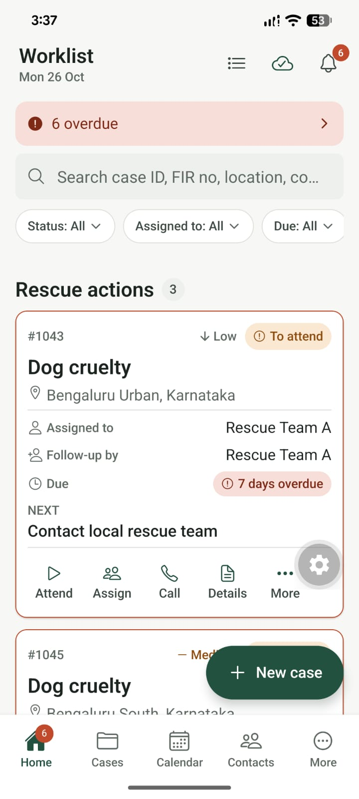
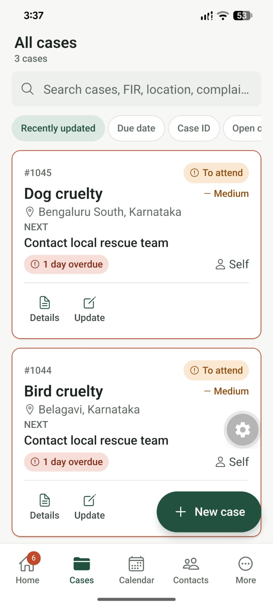
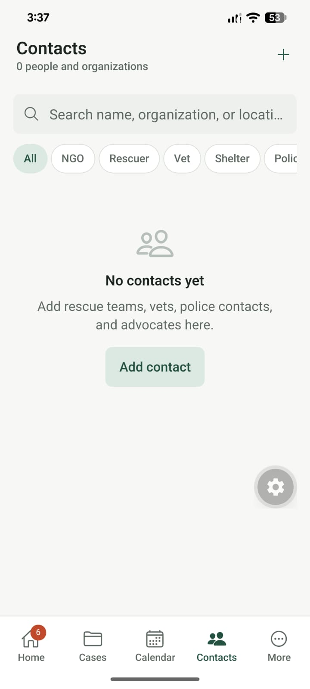
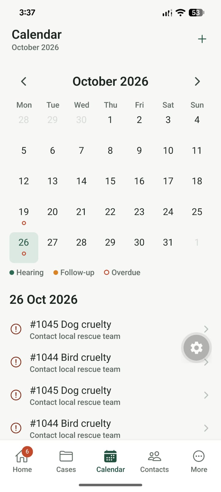
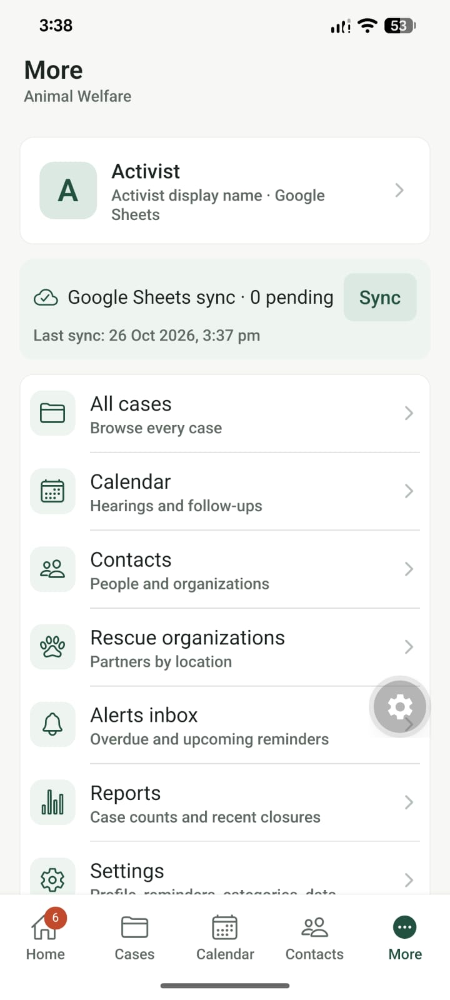

# Pawfile

A phone app for animal-rescue activists. It records complaints, tracks rescue and legal work
(police complaint, FIR, court hearings), assigns rescuers, keeps a contact directory, reminds you
about follow-ups, and backs up or syncs the data.

Built with Expo (React Native) and TypeScript. Every record is stored on the phone in SQLite, so
the app works with no account, no server, and no internet. Connecting the optional self-hosted
server lets several phones share one SQLite database and adds a read-only web dashboard.

**Installing on a phone:** a release APK is already published, so you do not need to build the
app. The setup and build sections below are only for running it from source or making changes.

## Screenshots

| Home | Cases | Contacts |
|:---:|:---:|:---:|
|  |  |  |
| Worklist, search, filters, and today's priorities | Every case with status and pending-sync chips | Rescue, legal, and veterinary contacts |

| Calendar | More |
|:---:|:---:|
|  |  |
| Hearings and follow-ups by day | Reports, backup, and settings |

---

## Requirements

| Item | Version / note |
|---|---|
| Node.js | `^22.13`, `^24.3`, or newer. Verified on 24.18.0 |
| npm | Ships with Node |
| Phone or emulator | Android or iOS |
| Hosting account | Optional. Only needed if you want the shared server on the internet (Render is configured) |

Nothing here requires a paid service for local use. Render requires a paid instance if you attach
the persistent disk that SQLite and uploads need.

---

## 1. Install

```bash
git clone <your-repository-url> pawfile
cd pawfile
npm install --include=dev
npm run stack:install
```

`--include=dev` matters if your global npm configuration sets `omit=dev`. The build needs
TypeScript and Jest.

`npm run stack:install` installs the two independent subprojects:

- `server/` — Node + Express + SQLite sync API
- `dashboard/` — Vite + React read-only web dashboard

Do not commit `node_modules/`, `server/data/`, `dashboard/dist/`, or any `.env` file. `.gitignore`
already excludes them.

---

## 2. Run it on a phone

1. Install **Expo Go** from the Play Store or the App Store.
2. Start the development server:

   ```bash
   npm start
   ```

3. Scan the QR code with Expo Go (Android) or the Camera app (iOS).
4. Keep the terminal running while you use the app.

The app starts with an empty worklist and stores everything locally on the phone. It is fully
usable without the shared server.

### Development build (needed for notifications)

Expo Go for SDK 58 is missing a native module that `expo-notifications` requires, so the app
deliberately skips notification scheduling there. Everything else works. The in-app Alerts inbox
still functions.

To test follow-up and hearing reminders you need a development build:

```bash
npx expo run:android      # Android Studio + a connected device or emulator
npx expo run:ios          # macOS only
```

A development build produces the `android/` or `ios/` folder locally. Both are gitignored because
Expo regenerates them.

---

## 3. Run the shared SQLite server (optional)

Skip this section if one phone is enough. Without it the app is fully functional offline.

With it, every device reads and writes the same SQLite database, uploaded photos and PDFs live on
the server, and the web dashboard shows the same data read-only.

### Local setup

1. Create `server/.env` from the template:

   ```bash
   cp server/.env.example server/.env
   ```

2. Set a long random `APP_SHARED_SECRET` (at least 16 characters). For example:

   ```bash
   openssl rand -hex 32
   ```

3. Start the API:

   ```bash
   npm run server:dev
   ```

   The server listens on `http://localhost:4000`. The SQLite file is
   `server/data/pawfile.db`; uploads go to `server/data/uploads/`.

4. In a second terminal, start the dashboard:

   ```bash
   npm run dashboard:dev
   ```

   Open <http://localhost:5173> and sign in with `APP_SHARED_SECRET`.

Or run both together:

```bash
npm run stack:dev
```

### Connect the app

1. Open **More → Settings → Data and sync → Shared backend**.
2. Enter the **server URL** (base URL only; do not include `/api/sync`):
   - Android emulator: `http://10.0.2.2:4000`
   - Physical phone on the same Wi-Fi: `http://<your-computer-LAN-IP>:4000`
   - Internet: `https://pawfile-server.onrender.com`
3. Enter the shared secret.
4. Tap **Test connection**, then **Save and sync**.

Plain HTTP is accepted only for localhost, `10.0.2.2`, and private LAN addresses. A public URL
must use HTTPS because the shared secret is a bearer credential.

### What happens on first sync

The app keeps every record locally and queues writes in an outbox. On the first sync with an empty
server it uploads the device's unsynced records, then pulls. If you have several phones with
different local records, connect **one phone first**, let it finish, and then connect the others.
The sync model is last-write-wins, so connecting divergent phones at the same time can discard a
local edit.

### Media

Photos, videos, and PDFs are uploaded to `server/data/uploads/<case number>/<category>/` and served
through signed URLs. The app stores the remote URL on the document record, so other devices can
display the media after they sync.

---

## 4. Deploy the server to Render (optional)

The repository includes [`render.yaml`](render.yaml). It defines one Node web service, a 1 GB
persistent disk mounted at `/var/data`, and a generated `APP_SHARED_SECRET`.

1. Push this repository to GitHub.
2. In Render, choose **New → Blueprint** and point it at the repository.
3. Render reads `render.yaml`. Approve the **Starter** plan; persistent disks are not available on
   the free plan.
4. Wait for the deploy. The health check is `GET /api/health`.
5. Open the Render service and copy:
   - the public URL (for example `https://pawfile-server.onrender.com`)
   - the generated `APP_SHARED_SECRET` from the environment variables
6. Enter both in **More → Settings → Data and sync → Shared backend**.
7. Open the server URL in a browser. The dashboard login should appear.

The deploy command builds the dashboard and starts the API. SQLite and uploads live on the
persistent disk at `/var/data`, so a redeploy preserves them.

Render notes:

- The disk requires a paid instance and pins the service to a single instance. Do not scale
  horizontally; SQLite is single-writer.
- Render does not back up disks. The server writes a daily `VACUUM INTO` snapshot to
  `server/data/backups/` and keeps the newest seven.
- Rotate `APP_SHARED_SECRET` in Render, then update every phone and the dashboard login.

---

## 5. Build a release (optional)

**You do not need this section to use the app.** A release APK is already published; build only
if you want your own copy or are changing the code.

### Before building

Replace the placeholders in [`app.json`](app.json):

| Field | Current placeholder |
|---|---|
| `expo.name` | `Pawfile` |
| `expo.slug` | `pawfile` |
| `ios.bundleIdentifier` | `com.animalwelfare.app` |
| `android.package` | `com.animalwelfare.app` |
| `extra.eas.projectId` | empty |
| Icons and splash | files under `assets/images/` |

### With EAS (recommended)

```bash
npm install -g eas-cli
eas login
eas init                 # creates eas.json and fills extra.eas.projectId
eas build --platform android --profile preview
```

For a store release, use `--profile production` and follow the prompts to create signing
credentials. iOS builds require an Apple Developer account.

### Set production behaviour

Create `.env.local` (gitignored) before building:

```dotenv
EXPO_PUBLIC_APP_ENV=production
```

Prefer entering the server URL and secret inside the app rather than putting them in `.env.local`;
a value in `.env.local` is compiled into the bundle and can be extracted.

### Local Android build

```bash
npx expo run:android --variant release
```

---

## 6. Verify a change

Run all of these before pushing:

```bash
npm run typecheck          # Expo app, tsc --noEmit
npm test                   # jest
npm run lint               # expo lint
npm run server:test        # server integration tests
npm run dashboard:build    # dashboard typecheck + Vite build
npx expo-doctor            # dependency and config checks
```

Optional bundle check, which catches Metro resolution errors that typecheck misses:

```bash
npx expo export --platform android --output-dir dist
npx expo export --platform web --output-dir dist-web
```

`dist/` and `dist-web/` are build output and are gitignored.

Server checks:

```bash
curl http://localhost:4000/api/health
```

A healthy response is `{"ok":true,"service":"pawfile-server"}`.

---

## 7. Where the data lives

| Data | Location |
|---|---|
| Cases, actions, hearings, contacts, history | SQLite `animal-welfare.db` in the app sandbox |
| Copies of attached media | App-private `media/<case number>/` |
| Automatic backups | App-private `backups/` — JSON, newest 4 kept, complainant details excluded |
| Shared database | `server/data/pawfile.db` on the server |
| Shared media | `server/data/uploads/` on the server |
| Server backups | `server/data/backups/` — daily SQLite snapshots, newest 7 kept |
| Dashboard | Read-only; served by the same server from `dashboard/dist/` |

Backups are merge-only: a restore adds missing records and never deletes anything. Manual export
produces JSON or a ZIP with media; complainant details are excluded unless explicitly included.

---

## 8. Troubleshooting

| Symptom | Cause | Fix |
|---|---|---|
| `npm install` skips dev packages | Global npm config sets `omit=dev` | Run `npm install --include=dev` |
| Metro cache serves stale code | Cached bundle | `npx expo start -c` |
| Notifications never fire | Running in Expo Go | Use `npx expo run:android` or an EAS build |
| App shows **On this device** | No server configured | More → Settings → Data and sync → Shared backend |
| App shows **Unauthorized** | Secret mismatch | Re-enter the exact `APP_SHARED_SECRET` |
| `Backend returned 404` | Wrong base URL | Use the server base URL, without `/api/sync` |
| App cannot reach a local server | Phone and computer are on different networks, or the URL uses `localhost` | Use the computer's LAN IP, or deploy to Render |
| Dashboard login fails | Secret mismatch or rate limit | Wait 15 minutes after five failures, then retry |
| Dashboard images are broken | The media URL token is invalid, or the file is missing | Check `server/data/uploads/` and the document status in the app |
| `File is too large` | Upload exceeds the 25 MB limit | Compress or trim the media |
| `database is locked` | A second server instance opened the same SQLite file | Run exactly one instance |
| Deploy loses data | The disk was not mounted at `/var/data` | Check the Render disk and the `DATABASE_PATH` / `UPLOADS_DIR` env vars |
| `npm test` fails with a module error | `node_modules` from an older install | Delete `node_modules` and reinstall |

---

## 9. Current scope

Implemented:

- Worklist with search, filters, overdue-first ordering, and an attention strip
- Three-step case intake with dependent state/district pickers, location fill, and media drafts
- Case details across Details, Rescue, Legal, History, and Documents
- Update flow with rescue/legal status, assignee, next action, due date, FIR and court fields
- Rescue assignment with contact search, call, masked WhatsApp share, and decline/reassign
- Legal workflow with multiple hearings, reminders, and outcome recording
- Contacts and rescue directory with full CRUD
- Calendar agenda, alerts inbox, reports, and settings
- Offline queue, batched sync, last-write-wins conflict history, device case-ID blocks
- Self-hosted Node + SQLite sync server with media storage and signed file URLs
- Read-only web dashboard for KPIs, cases, contacts, hearings, documents, and activity
- Weekly on-open backup with in-app restore, plus merge-only JSON/ZIP restore
- 36 states/UTs and 786 districts, with a custom-district fallback

Not in V1:

- No user accounts or per-person access control; one shared secret protects everything
- The dashboard is read-only; editing stays in the app
- Reminders fire only on the device that created them; the Alerts inbox is shared
- No real-time sync — polling every five minutes
- No duplicate-complaint detection
- Automatic backups run on app open, not as an OS background task, and exclude media
- The shared server is single-instance because it uses SQLite

Security model, patched findings, and accepted risks: [`docs/security.md`](docs/security.md).

---

## 10. Documentation

| Document | Contents |
|---|---|
| [`docs/app-overview.md`](docs/app-overview.md) | What the app is and what V1 covers |
| [`docs/backend-setup-guide.md`](docs/backend-setup-guide.md) | Step-by-step SQLite server setup, local and Render |
| [`docs/security.md`](docs/security.md) | Threat model, fixes, accepted risks |
| [`server/README.md`](server/README.md) | Technical API contract and server reference |
