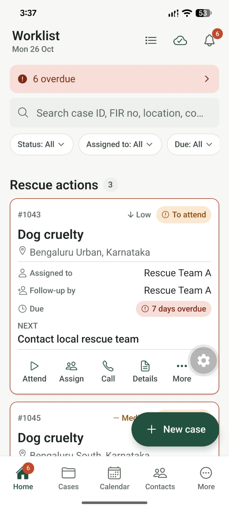
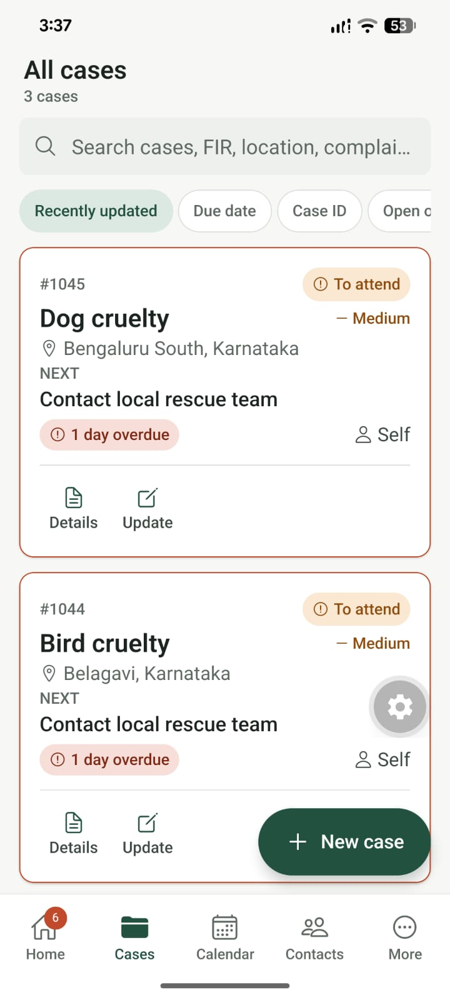
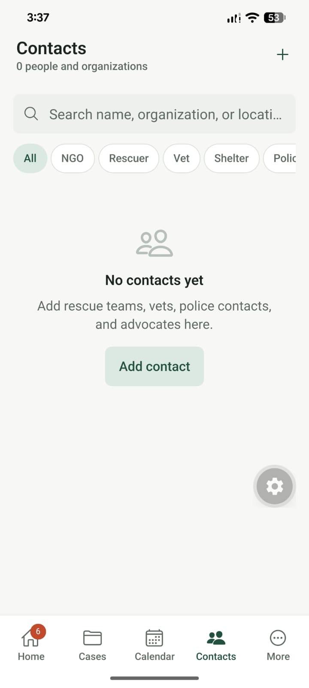
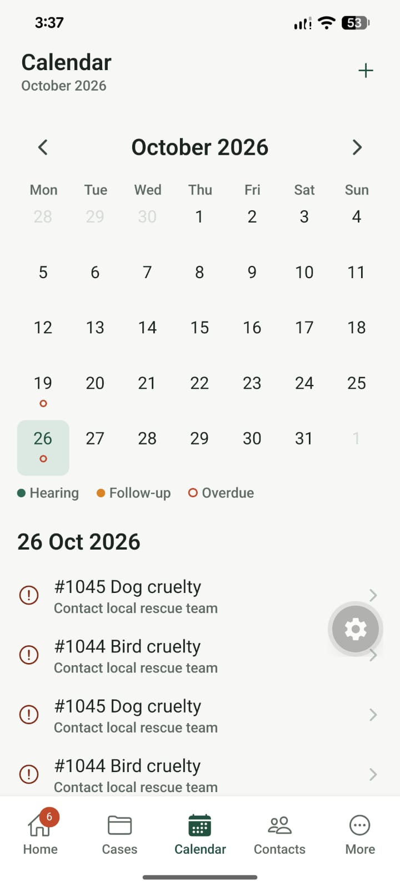
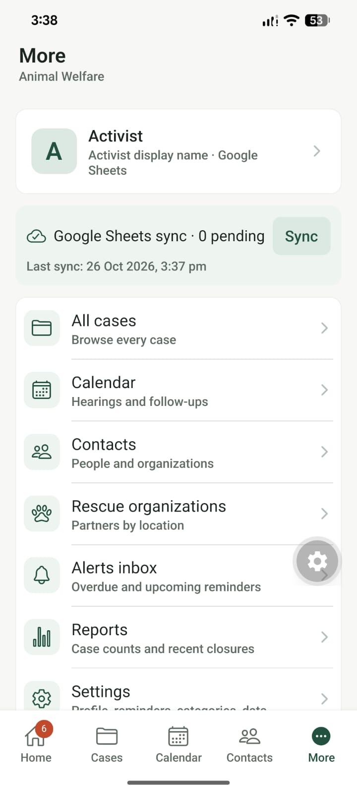

# Animal Welfare

A phone app for animal-rescue activists. It records complaints, tracks rescue and legal work
(police complaint, FIR, court hearings), assigns rescuers, keeps a contact directory, reminds you
about follow-ups, and backs up or syncs the data.

Built with Expo (React Native) and TypeScript. Every record is stored on the phone in SQLite, so
the app works with no account, no server, and no internet. Connecting the optional Google Sheets
backend lets several phones share one dataset.

## Screenshots

| Home | Cases | Contacts |
|:---:|:---:|:---:|
|  |  |  |
| Worklist, search, filters, and today's priorities | Every case with status and pending-sync chips | Rescue, legal, and veterinary contacts |

| Calendar | More |
|:---:|:---:|
|  |  |
| Hearings and follow-ups by day | Reports, backup, and settings |

---

## Requirements

| Item | Version / note |
|---|---|
| Node.js | `^22.13`, `^24.3`, or newer. Verified on 24.18.0 |
| npm | Ships with Node |
| Phone or emulator | Android or iOS |
| Google account | Only needed for shared data between devices |

Nothing here requires a paid service. The shared backend runs on Google's free Apps Script quota.

---

## 1. Install

```bash
git clone <your-repository-url> animal-welfare
cd animal-welfare
npm install --include=dev
```

`--include=dev` matters if your global npm configuration sets `omit=dev`. The build needs
TypeScript and Jest.

Do not commit `node_modules/` or any `.env` file. `.gitignore` already excludes both.

---

## 2. Run it on a phone

1. Install **Expo Go** from the Play Store or the App Store.
2. Start the development server:

   ```bash
   npm start
   ```

3. Scan the QR code with Expo Go (Android) or the Camera app (iOS).
4. Keep the terminal running while you use the app.

On first launch the app seeds demo cases so the worklist is not empty. Before entering real data,
remove them with **More → Settings → Data and sync → Remove demo data**.

### Development build (needed for notifications)

Expo Go for SDK 58 is missing a native module that `expo-notifications` requires, so the app
deliberately skips notification scheduling there. Everything else works. The in-app Alerts inbox
still functions.

To test follow-up and hearing reminders you need a development build:

```bash
npx expo run:android      # Android Studio + a connected device or emulator
npx expo run:ios          # macOS only
```

A development build produces the `android/` or `ios/` folder locally. Both are gitignored because
Expo regenerates them.

---

## 3. Connect the shared Google backend (optional)

Skip this section if one phone is enough. Without it the app is fully functional offline.

With it, every device reads and writes the same Google Sheet, and photos, videos, and PDFs are
uploaded to Google Drive.

### Short version

1. Create a blank Google Sheet named **Animal Welfare**. Copy the ID from its URL
   (`https://docs.google.com/spreadsheets/d/<ID>/edit`).
2. Open <https://script.google.com>, create a project, and replace `Code.gs` with
   [`backend/apps-script/Code.gs`](backend/apps-script/Code.gs).
3. In **Project Settings → Script Properties**, add:
   - `SPREADSHEET_ID` — the ID from step 1
   - `APP_SHARED_SECRET` — a random string of **at least 16 characters**
   - `DRIVE_ROOT_FOLDER_ID` — optional; a folder is created if omitted
4. Run `setupSpreadsheet` once from the editor and approve the Google permissions.
5. **Deploy → New deployment → Web app**, with **Execute as: Me** and
   **Who has access: Anyone**. Copy the URL ending in `/exec`.
6. In the app: **More → Settings → Data and sync → Shared backend**. Paste the URL and the secret,
   tap **Test connection**, then **Save and sync**.

The full walkthrough, written for non-technical users, is
[`docs/backend-setup-guide.md`](docs/backend-setup-guide.md).

### Things that surprise people

- **The secret is the only protection.** Anyone who has the `/exec` URL and the secret can read and
  change every case, including complainant names and phone numbers. Treat it as a password.
- **Remove demo data before connecting**, or the sample cases are pushed into the shared Sheet.
- **Photos live in Drive, not in the Sheet.** The Sheet's `Documents` tab stores the file name,
  upload status, and Drive link. The image itself is a file in Drive under
  `Animal Rescue App/Cases/#<case number>/`.
- **The app only accepts `https://script.google.com/.../exec`.** This stops a pasted URL from
  receiving the secret.
- **After editing `Code.gs`, redeploy a new version** (Deploy → Manage deployments → pencil →
  New version). Saving the file alone does not update the live endpoint.
- **Settings → Categories is per device.** To ship the same lists to everyone, edit
  [`src/config/defaults.ts`](src/config/defaults.ts) and rebuild.

---

## 4. Build a release

### Before building

Replace the placeholders in [`app.json`](app.json):

| Field | Current placeholder |
|---|---|
| `expo.name` | `Animal Welfare` |
| `expo.slug` | `animal-welfare` |
| `ios.bundleIdentifier` | `com.animalwelfare.app` |
| `android.package` | `com.animalwelfare.app` |
| `extra.eas.projectId` | empty |
| Icons and splash | files under `assets/images/` |

### With EAS (recommended)

```bash
npm install -g eas-cli
eas login
eas init                 # creates eas.json and fills extra.eas.projectId
eas build --platform android --profile preview
```

For a store release, use `--profile production` and follow the prompts to create signing
credentials. iOS builds require an Apple Developer account.

### Set production behaviour

Create `.env.local` (gitignored) before building:

```dotenv
EXPO_PUBLIC_APP_ENV=production
EXPO_PUBLIC_DEMO_MODE=false
```

Demo seeding is off when `EXPO_PUBLIC_APP_ENV=production`, but setting `EXPO_PUBLIC_DEMO_MODE=false`
explicitly is safer. Prefer entering the backend URL and secret inside the app rather than putting
them in `.env.local`; a value in `.env.local` is compiled into the bundle and can be extracted.

### Local Android build

```bash
npx expo run:android --variant release
```

---

## 5. Verify a change

Run all four before pushing:

```bash
npm run typecheck        # tsc --noEmit
npm test                 # jest, 41 tests
npm run lint             # expo lint
npx expo-doctor          # dependency and config checks
```

Optional bundle check, which catches Metro resolution errors that typecheck misses:

```bash
npx expo export --platform android --output-dir dist
npx expo export --platform web --output-dir dist-web
```

`dist/` and `dist-web/` are build output and are gitignored.

---

## 6. Configuration reference

All variables are optional. The app runs with none of them set.

| Variable | Default | Purpose |
|---|---|---|
| `EXPO_PUBLIC_APP_ENV` | `development` | `production` disables demo seeding |
| `EXPO_PUBLIC_SHEETS_ENDPOINT` | empty | Build-time Apps Script `/exec` URL |
| `EXPO_PUBLIC_SHEETS_SECRET` | empty | Build-time shared secret, 16+ characters |
| `EXPO_PUBLIC_DEMO_MODE` | `true` in dev, `false` in production | Seed demo records on first launch |
| `EXPO_PUBLIC_DEFAULT_ACTOR_NAME` | `Activist` | Display name written into history entries |

Copy [`.env.example`](.env.example) to `.env.local` to start. Runtime values entered in
**Settings → Shared backend** override build-time values and are stored in the device keychain.

---

## 7. Where the data lives

| Data | Location |
|---|---|
| Cases, actions, hearings, contacts, history | SQLite `animal-welfare.db` in the app sandbox |
| Copies of attached media | App-private `media/<case number>/` |
| Automatic backups | App-private `backups/` — JSON, newest 4 kept, complainant details excluded |
| Shared copy | Google Sheet tabs: `Cases`, `Actions`, `Hearings`, `Contacts`, `Documents`, `History`, `SyncMetadata`, `Config` |
| Shared media | Google Drive under `Animal Rescue App/Cases/#<case number>/` |

Backups are merge-only: a restore adds missing records and never deletes anything. Manual export
produces JSON or a ZIP with media; complainant details are excluded unless explicitly included.

---

## 8. Troubleshooting

| Symptom | Cause | Fix |
|---|---|---|
| `npm install` skips dev packages | Global npm config sets `omit=dev` | Run `npm install --include=dev` |
| Metro cache serves stale code | Cached bundle | `npx expo start -c` |
| Notifications never fire | Running in Expo Go | Use `npx expo run:android` or an EAS build |
| App shows **On this device** | No backend configured | More → Settings → Data and sync → Shared backend |
| `Unauthorized` | Secret mismatch, under 16 characters, or stale deployment | Re-enter the secret; redeploy a new version |
| `Backend returned 404` | `/dev` URL instead of `/exec` | Use the URL ending in `/exec` |
| Google login page in a browser | Deployment access is not **Anyone** | Edit the deployment settings |
| App shows `Unknown sheet` | Sheet tabs were never created | Run `setupSpreadsheet` again |
| Photos missing from Drive | Wrong Google account, or upload failed | Check the deploying account and the document status in the app |
| Sync stops after editing `Code.gs` | Old version still deployed | Deploy → Manage deployments → New version |
| `npm test` fails with a module error | `node_modules` from an older install | Delete `node_modules` and reinstall |

---

## 9. Project layout

```text
app/                       expo-router screens
src/theme/                 design tokens and status colours
src/components/            shared and domain components
src/config/                defaults, India locations, environment
src/db/                    SQLite schema and client
src/data/                  types, repositories, queue, sync, services, seed
src/hooks/                 data hooks
src/services/              notifications, sharing, media, uploads, backup
backend/apps-script/       Sheets + Drive backend (Code.gs)
docs/                      published docs plus local-only specs and wireframes
changelog/                 implementation history (local only)
assets/                    icons, splash, fonts, screenshots
```

The app is local-first. Screens read from SQLite through repositories, and writes queue locally
before syncing. Sync runs every five minutes, on network regain, and when the app returns to the
foreground.

---

## 10. What is committed to git

Committed:

```text
app/  src/  assets/  backend/apps-script/
docs/app-overview.md  docs/backend-setup-guide.md  docs/security.md
app.json  package.json  package-lock.json  tsconfig.json
babel.config.js  metro.config.js  .gitignore  .env.example  README.md
```

Only those three files in `docs/` are published. The rest of `docs/` — the product plan, design
spec, architecture notes, and wireframes — stays local, and so does the whole `changelog/`. The
rules use `docs/*` plus `!` allow-list entries; to publish another doc, add a matching
`!docs/<file>` line to `.gitignore`.

Ignored:

| Path | Why |
|---|---|
| `node_modules/` | Reinstall with `npm install` |
| `.env`, `.env.*` | Contains the shared secret |
| `.expo/` | Local Expo cache |
| `dist/`, `dist-web/`, `web-build/` | Build output; bundles can contain a baked-in secret |
| `expo-env.d.ts` | Regenerated by Expo |
| `android/`, `ios/` | Regenerated by `expo prebuild` / `expo run` |
| `*.jks`, `*.keystore`, `*.p8`, `*.p12`, `*.key`, `*.pem`, `*.mobileprovision` | Signing material |
| `credentials.json`, `clasprc.json`, `google-services.json` | Google credentials and tokens |
| `coverage/`, `*.log`, `*.tsbuildinfo` | Local artifacts |
| `.commandcode/` | Per-machine tool preferences |
| `changelog/` | Implementation history, kept local |
| `docs/*` except the three allow-listed files | Plan, design spec, architecture notes, wireframes |

Keep `package-lock.json` committed. It pins the dependency tree.

If you ever decide to commit the native `android/` and `ios/` folders, delete those two lines from
`.gitignore` first; the build-output rules further down still apply.

---

## 11. Current scope

Implemented:

- Worklist with search, filters, overdue-first ordering, and an attention strip
- Three-step case intake with dependent state/district pickers, location fill, and media drafts
- Case details across Details, Rescue, Legal, History, and Documents
- Update flow with rescue/legal status, assignee, next action, due date, FIR and court fields
- Rescue assignment with contact search, call, masked WhatsApp share, and decline/reassign
- Legal workflow with multiple hearings, reminders, and outcome recording
- Contacts and rescue directory with full CRUD
- Calendar agenda, alerts inbox, reports, and settings
- Offline queue, batched sync, last-write-wins conflict history, device case-ID blocks
- Weekly on-open backup with in-app restore, plus merge-only JSON/ZIP restore
- 36 states/UTs and 786 districts, with a custom-district fallback

Not in V1:

- No user accounts or per-person access control; one shared secret protects everything
- Reminders fire only on the device that created them; the Alerts inbox is shared
- No real-time sync — polling every five minutes
- No duplicate-complaint detection
- No web app; the web export exists for development
- Automatic backups run on app open, not as an OS background task, and exclude media

Security model, patched findings, and accepted risks: [`docs/security.md`](docs/security.md).

---

## 12. Documentation

| Document | Contents |
|---|---|
| [`docs/app-overview.md`](docs/app-overview.md) | What the app is and what V1 covers |
| [`docs/backend-setup-guide.md`](docs/backend-setup-guide.md) | Step-by-step Google backend setup, written for non-technical users |
| [`docs/security.md`](docs/security.md) | Threat model, fixes, accepted risks |
| [`backend/apps-script/README.md`](backend/apps-script/README.md) | Short technical backend reference |
# Pawfile

